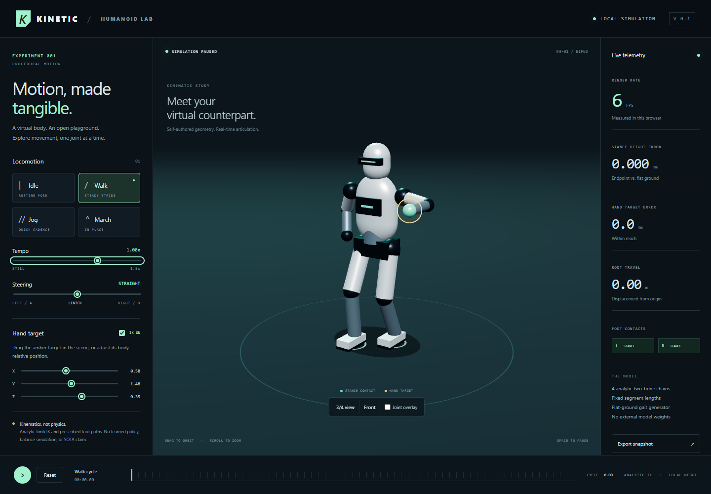
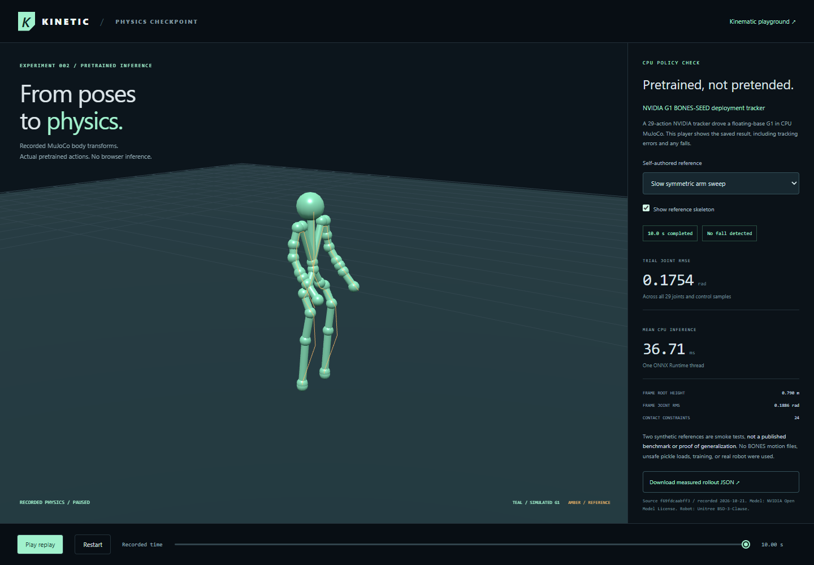
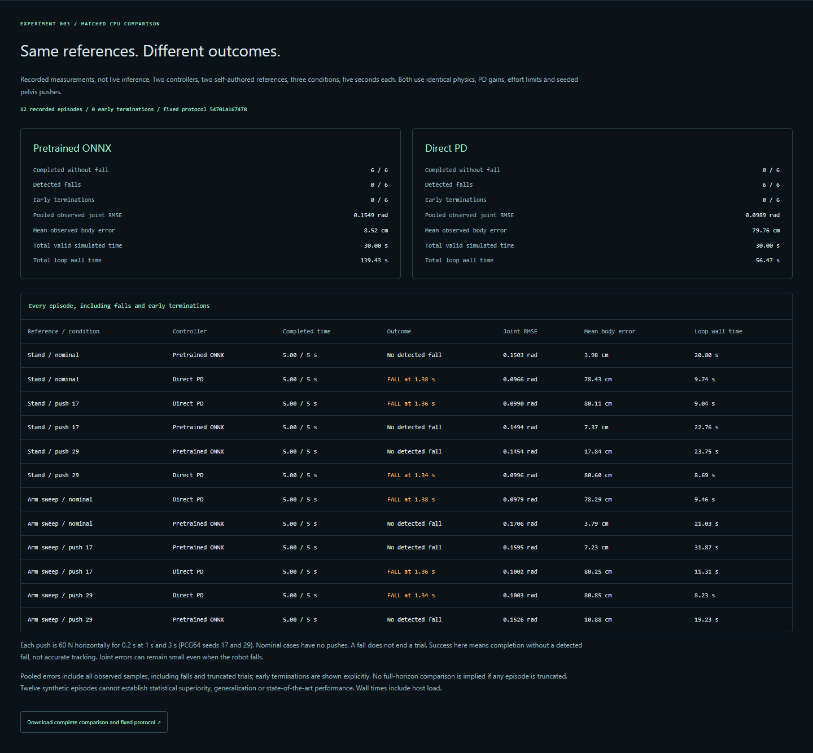
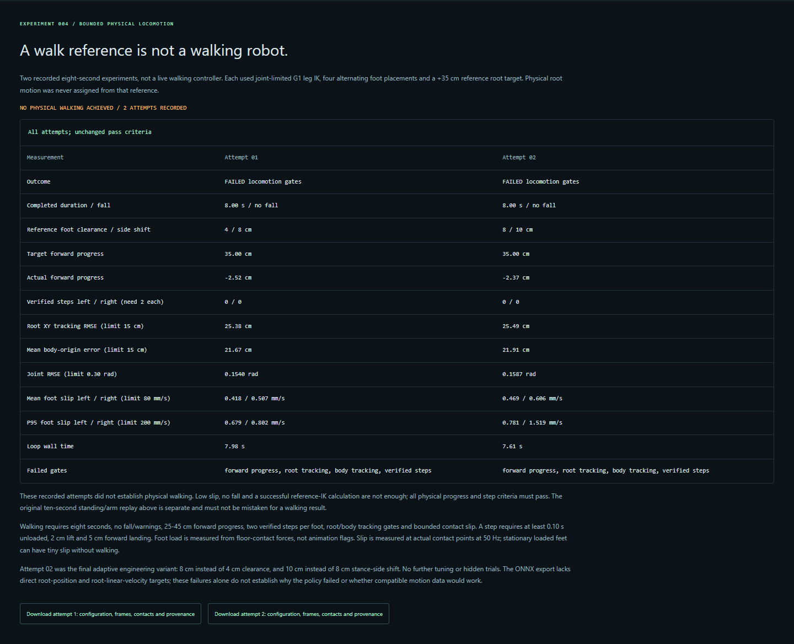

# Kinetic / Humanoid Lab

A local, interactive 3D humanoid playground with analytic limb inverse kinematics, a procedural gait generator, reachable hand-target interaction, and live numerical diagnostics. Built with TypeScript, Three.js and Vite; the playground's robot geometry is authored in code. No API keys or paid services.

**The interactive playground is a kinematic baseline, not a learned physics controller or a state-of-the-art result.** Feet follow prescribed paths; its body does not simulate forces, contact dynamics, balance, or falls. Small IK residuals are implementation checks, not evidence of physical tracking performance.

**A separate pretrained-physics checkpoint now runs actual G1 control in CPU MuJoCo.** Two 10-second synthetic-reference trials completed without detected falls. Its [recorded browser replay](physics.html) shows real simulation body transforms and tracking errors; it is not live browser inference. See [the reproduction guide and measured results](research/README.md). Model weights stay in an ignored local cache, not in the repository or web bundle.

**A fixed matched comparison now includes the failures too.** Across six five-second cases per controller (two references, nominal and two seeded push conditions), pretrained ONNX had 0/6 falls and direct PD had 6/6. Direct PD nevertheless had **lower joint RMSE and shorter wall time**. The physics page includes every episode, pooled errors and full protocol provenance; this is a small synthetic comparison, not a published benchmark.

**Physical walking has not been achieved.** Two bounded eight-second, self-authored slow-walk experiments completed without falls, but neither foot took a verified step and the roots moved slightly backward. Both failed the progress and world-space tracking criteria. Their complete configurations, contact/slip telemetry, failed gates and frames are retained—not presented as successful walking.

**The subsequent [contract diagnosis](research/CONTRACT-AUDIT.md) found no deployment mismatch in the inspected fields.** Controlled target changes reach the actual ONNX graph and alter its commands, but support transfer remains insufficient; no actuator torque limits were reached. Instrumented runs reproduced both historical root trajectories and checked metrics exactly. A known-compatible locomotion reference remains the missing positive control, with motion-data licensing treated separately from model licensing.





## Run locally

Requires Node.js 22.18+ (tested on Node 24.22.1), npm, and a WebGL2-capable browser.

```powershell
npm ci
npm run dev
```

Open the loopback URL printed by Vite. For the production demo:

```powershell
npm run build
npm run preview
```

Open **http://127.0.0.1:4173**. The server binds to loopback, not the public network. Stop it with Ctrl+C. After dependency installation the app makes no external asset, font, model, analytics, or API requests.

The measured physics replay is at **http://127.0.0.1:4173/physics.html**. Viewing its committed data requires no Python installation. Reproducing the policy rollout requires the separate optional [Python 3.11 CPU environment](research/README.md).

The same page's comparison section reads `public/physics-comparison.json`, separate from the unchanged ten-second replay. Reproduce its fixed twelve-episode matrix with `research\.venv\Scripts\python.exe research\evaluate.py` after following the Python setup guide.

Failed locomotion evidence is at **http://127.0.0.1:4173/physics.html#locomotion-heading**. See the [bounded experiment and reproduction commands](research/README.md#bounded-physical-locomotion-experiment). Attempt files are immutable; use a separate output directory when reproducing them.

## Explore

| Control | Behavior |
| --- | --- |
| Idle / Walk / Jog / March | Resting motion, translating gaits, or high stepping in place |
| Tempo | Scales cadence and translation together; zero stops the gait |
| Steering / A and D / arrow keys | Turns the body; Center clears the steering slider |
| Amber hand target | Drag in a camera-facing plane; X/Y/Z sliders are a keyboard-accessible alternative |
| IK toggle | Switches the right arm between target reaching and procedural arm swing |
| Orbit / zoom / camera presets | Drag empty scene space, scroll, or choose front / three-quarter views |
| Joint overlay | Draws the actual two-bone chains over the robot |
| Pause / Space | Freezes simulation time and locomotion; camera and target editing remain available |
| Reset | Returns time, root position, heading and hand target to their initial values; preserves selected mode, tempo and paused state |
| Export snapshot | Downloads current mode, target, residuals, contacts, render statistics and position as JSON |

All coordinates and IK residuals are in meters internally. The UI displays errors in millimeters. The target is body-relative: it travels and turns with the humanoid. Out-of-workspace targets clamp to the closest point on the arm's reach shell, with an explicit residual rather than a false success.

## Model and measurable checks

`src/kinematics.ts` is independent of rendering. It contains a two-bone geometric IK solver with degenerate-direction handling, four motion presets and deterministic time integration. Leg segments are each 0.48 m. Arm segments are 0.30 m and 0.29 m. Stance takes 62% of a gait cycle; stance travel cancels root translation during straight walking, while smooth swing paths clear the flat ground. The prescribed hip height stays within leg reach.

```powershell
npm test
npm run build
npx playwright install chromium --only-shell
npm run test:browser
```

The numerical tests print their measured maxima and enforce these thresholds:

| Check | Coverage | Required result |
| --- | --- | --- |
| IK segment-length preservation | 10,000 deterministic targets, including unreachable targets | Absolute error < 0.0000001 m |
| Reachable target residual | Reachable subset of the same targets | < 0.0000001 m |
| Stance endpoint height | 19,200 poses across 4 modes and 4 tempo values | < 0.1 mm |
| Straight-line stance foot slide | 7,200 simulation steps across walk/jog and 3 tempos | < 0.1 mm per step |
| Degenerate targets | Coincident root, parallel pole, far target, invalid inputs | Finite valid solutions or explicit input error |
| Gait boundary continuity | Stance/swing and cycle boundaries | Position difference < 0.0000001 m |
| Pause, reset, replay | Identical input sequences | Exact deterministic state equality |

Browser tests run serially to limit memory use, with a bounded four-minute timeout per test and up to one minute for software-rendered replay readiness on loaded machines. They use Chromium's software WebGL backend so the smoke test does not depend on a dedicated GPU. They exercise all motion modes, pause/reset, tempo, steering, target reach limits, direct target dragging, keyboard pause, overlay, export and mobile layout, plus physics replay controls, all comparison rows including failures, both failed locomotion attempts, responsive tables, and explicit missing/unfinished-data errors. Screenshots are written to `test-results/kinetic-desktop.png`, `test-results/kinetic-mobile.png`, `test-results/kinetic-physics.png`, `test-results/kinetic-comparison.png` and `test-results/kinetic-locomotion.png`. Both viewers redraw paused scenes only after interaction or a camera/viewport change. The exported FPS counts actual renders, so it can drop to zero while paused; it is not a promised hardware-independent rate.

### Recorded local checks

Node 24.22.1 and Python 3.11.9 on Windows: **6 kinematics tests, 21 Python physics/evidence tests, and all 8 browser checks passed**, and the TypeScript / Vite production build passed. The three original playground browser checks passed in the full run; two physics checks initially exceeded the 15-second software-renderer readiness wait. After bounding that readiness wait at 60 seconds, the targeted five physics checks all passed in 4.1 minutes. Trace recording remains disabled for memory use. These are software/measurement checks: **the physical walking criteria failed in both recorded attempts**.

| Measured diagnostic | Maximum |
| --- | --- |
| IK segment-length error, 10,000 targets | 1.05e-15 m |
| Reachable IK target residual | 2.29e-16 m |
| Stance endpoint height error, 19,200 poses | 1.39e-16 m |
| Straight-line stance slide per step, 7,200 steps | 2.07e-15 m |

These near-machine-precision results are expected for an analytic geometric construction. They do **not** measure physical stability, contact forces, learned-motion quality, or benchmark success rate. The live scene reported 7,938 rendered triangles and 43 draw calls in one sampled pose. Software-rendered screenshot runs were substantially slower than the embedded browser, which sampled approximately 60 FPS; neither is a controlled performance benchmark. Vite emits a non-fatal bundle-size advisory for the shared Three.js chunk (505 kB minified / 126 kB gzip); the playground and physics/evidence entry scripts are about 20 and 22 kB respectively.

## Playground limitations

- The interactive playground has no physics engine, torque or PD controller, collision avoidance, self-collision test, terrain adaptation, learned motion prior, motion capture dataset, text-to-motion model, or real-robot transfer. The separate research checkpoint uses real MuJoCo contacts and pretrained PD targets; its own limitations and metrics are documented separately.
- Contact indicators represent the **scheduled kinematic stance**, not force sensors or simulated contacts.
- Straight-line stance cancellation does not extend to turning; turning can produce visible foot sliding. Mode/tempo changes are immediate and not transition-blended. Swing trajectories are position-continuous but not velocity-matched at the stance boundary.
- The displayed root travel is displacement from the origin, not accumulated path length. The floor and camera follow the root; the visible ring is a moving reference, not a fixed platform.
- The 100 ms elapsed-time cap intentionally slows simulation after long stalls rather than jumping forward. Determinism requires the same time-step/input sequence.
- The robot has fixed proportions and no explicit anatomical joint limits. The reach solver prevents segment stretching but not body intersections.
- Integrated Intel HD Graphics 520 is a target for lightweight browser use, not a training platform. Actual browser compatibility and render rate depend on drivers, memory pressure and WebGL2 support.

## Research context: primary sources, not reproduced results

The following references contextualize the distance between this baseline and modern learned humanoid control. Their results are **author-reported**, not measured by this repository, and are not directly comparable to our geometric residual tests.

| Work | Relevant idea | Distinction from this demo |
| --- | --- | --- |
| [SuperMimic (2026)](https://arxiv.org/abs/2610.28480), [project](https://supermimic.github.io) | Differentiable world model plus motion tracker; authors report normalized return above 0.90 after 3 hours on one H100, 25 failures among 129,514 training-set benchmark motions, and zero after 9.8 hours on two GPUs | Training-set coverage is not generalization. No weights, training, physical tracking or benchmark reproduction here |
| [SWAP (2026)](https://arxiv.org/abs/2610.25711) | High-level diffusion collision avoidance with low-level RL tracking; authors report an average 34% improvement in targeted rewards | No collision reasoning or RL in this baseline; no reproduction |
| [MaskedMimic (2024)](https://arxiv.org/abs/2409.14393) | Unified masked-motion-inpainting physics-based control | A foundational learned-control comparison, not a capability this procedural model implements |

SuperMimic's [browser-demo license](https://supermimic.github.io/demo/LICENSE.html) is proprietary and permits personal browser evaluation only, with restrictions on redistribution, derivatives, automated access and evaluation of other systems using its outputs. **No code, weights, assets or outputs from that demo are included, downloaded or automated here.**

### Verified optional CPU inference, not benchmark reproduction

[NVIDIA ProtoMotions installation documentation](https://github.com/NVlabs/ProtoMotions/blob/main/docs/source/getting_started/installation.rst) and [pretrained-model documentation](https://github.com/NVlabs/ProtoMotions/blob/main/docs/source/getting_started/pretrained_models.rst) describe CPU-only MuJoCo deployment. This repository now verifies the **smaller standalone ONNX route**, pinned to source revision `f69fdcaabff31846b4d2247207417b57dc788828`, instead of installing the full training framework or loading pickle checkpoints.

The 22.6 MB `g1-bones-deploy` export drove two self-authored references for 500 policy calls and 10,000 physics steps each. Stand / slow-arm-sweep joint RMSE was **0.151715 / 0.175384 radians**, mean body-origin error **3.981 / 3.753 cm**, with no detected falls or numerical warnings in either 10-second trial. Wall times were **58.05 / 40.08 seconds**: slower than real time on the loaded machine. This is a narrow deployment smoke test, not a training achievement or published benchmark comparison.

The `g1_bones_seed_mini` dataset was **not downloaded or used** because the user's motion-data access terms were not established. No claims are made about the upstream motion corpus. Full provenance, fall definition, limitations, exact package pins and reproducible commands are in [research/README.md](research/README.md); measured frames and metrics are in [public/physics-replay.json](public/physics-replay.json).

That tracker consumes reference motion, not text; its 29-action mapping, PD gains, observation history and joint ordering must match the deployment contract. The source is Apache-2.0; weights use the NVIDIA Open Model License, with separate robot and motion-data terms. SMPL MaskedMimic checkpoints are IsaacLab-only and should not be confused with this G1 deployment route. Before claiming progress toward published results, reproduce a named physical benchmark with a pinned model/data version, episode count, tracking errors, failure definition, runtime, and hardware.

### Matched reference-PD comparison

The fixed protocol adds two 60 N, 0.2-second horizontal pelvis pushes at 1 s and 3 s, with PCG64 seeds 17 and 29, alongside nominal cases. Both controllers share the same physics, gains, effort limits, initial state and references. Direct PD sends current reference joint positions to the actuators without learned balance correction. All twelve trials completed five seconds, including the six that fell; none terminated early or produced numerical warnings.

| Across six cases per controller | Pretrained ONNX | Direct PD |
| --- | ---: | ---: |
| Completed without a detected fall | 6 / 6 | 0 / 6 |
| Pooled joint RMSE | 0.154867 rad | 0.098948 rad |
| Mean body-origin error | 0.085157 m | 0.797560 m |
| Total simulated / loop wall time | 30 / 139.43 s | 30 / 56.47 s |

Direct PD was faster and had lower joint-angle error, but fell even without pushes. The learned controller stayed upright, but did not perfectly track world position. This is evidence against treating joint error alone as physical success, not proof of general superiority or a calibrated robustness benchmark. [All cases and accounting rules](research/README.md#fixed-matched-comparison) include failures, truncated-run handling and exact provenance.



### Physical locomotion: failed experiment retained

The self-authored reference uses the actual G1 six-joint leg Jacobians, joint/tendon limits, flat-foot orientation, stationary stance feet and coherent joint velocities. The original playground's generic two-bone IK is not used as if it were G1 physics. The planned root trajectory influences reference IK and metrics only; simulated root positions are never overwritten after initialization.

| Fixed eight-second attempts | Attempt 01 | Attempt 02 |
| --- | ---: | ---: |
| Target / actual root advance | +35 / **-2.52 cm** | +35 / **-2.37 cm** |
| Verified steps, left / right | **0 / 0** | **0 / 0** |
| Root XY RMSE (limit 15 cm) | **25.38 cm** | **25.49 cm** |
| Mean body-origin error (limit 15 cm) | **21.67 cm** | **21.91 cm** |
| Falls / numerical warnings | 0 / 0 | 0 / 0 |
| Overall walking criteria | **Failed** | **Failed** |

The second and final attempt increased reference clearance and lateral shift without relaxing any success criterion. Both feet stayed loaded at every post-initial sample. Consequently, low measured contact slip reflects planted feet, **not successful locomotion**. The policy export has no direct root-position/linear-velocity target input; kinematic reference feasibility alone did not yield a physically tracked walk. This does not prove the policy cannot walk with compatible reference motions. No further tuning or hidden trials were performed.



## Structure

```text
src/kinematics.ts        Renderer-independent analytic IK and gait
src/main.ts              Geometry, scene, interaction and diagnostics
src/style.css            Responsive laboratory interface
src/physics.ts           Viewer for recorded CPU policy/physics results
research/                Optional pinned CPU inference runner and contract tests
public/physics-replay.json Measured rollout output (no weights or motion dataset)
research/evaluate.py     Fixed paired-controller comparison and aggregation
public/physics-comparison.json All twelve measured comparison cases and protocol
research/locomotion.py    Bounded G1 IK reference and force-verified locomotion experiment
public/locomotion/       Both failed attempts, complete telemetry and derived summary
tests/kinematics.test.ts Numerical invariants and motion checks
tests/browser.spec.ts    Browser controls, reach interaction and screenshots
tests/physics.spec.ts    Recorded replay controls and explicit missing-data error
```

Three.js is MIT-licensed; no third-party humanoid assets are bundled. Dependency versions are locked in `package-lock.json`.
