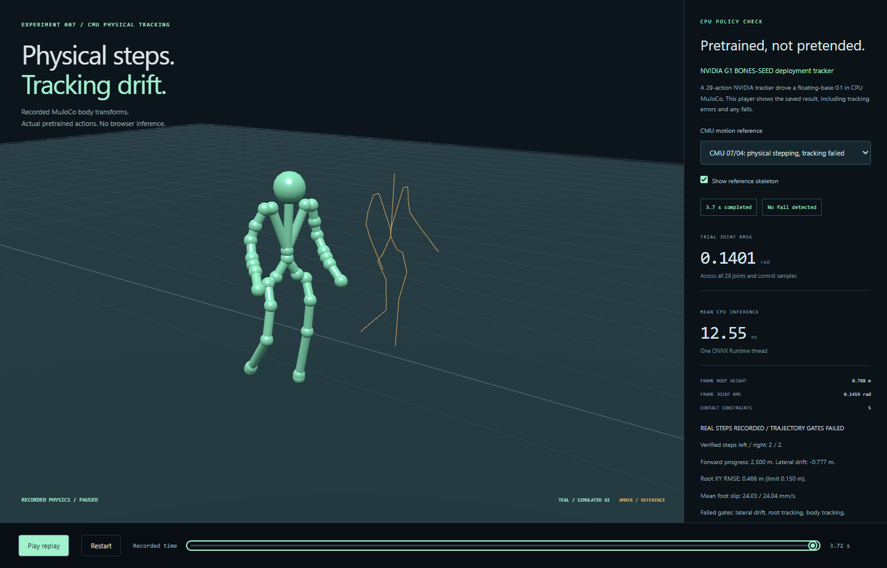

# CMU retarget repair: real physical steps, failed trajectory tracking

**The repaired reference produced two verified steps per foot and 2.499748 m forward travel in actual CPU MuJoCo, with no fall or numerical warning.** It did **not** pass the complete physical walking criteria: lateral drift, root XY tracking and body-position tracking failed. The viewer at `http://127.0.0.1:4173/physics.html?replay=cmu` replays measured simulated transforms alongside the reference, including their separation. It is not live inference or reference animation substituted for physics.

This is one 3.72-second trial of the same CMU subject 07/trial 04, without time warping, new motion data, policy tuning or training. It starts from a moving reference pose and velocity, not from rest. All v1 and earlier measured artifacts remain unchanged.

## Repairs and independent controls

The v1 failure was not treated as evidence of physical infeasibility. Three local problems were repaired.

**Contact semantics:** human forefoot/toe bone endpoints are not sole-surface markers. Their absolute height is therefore not a reliable ground-contact test. In v1, the slowly moving right foot at 3.10 s was rejected solely because its endpoint height exceeded one global cutoff. The new walking-specific estimator requires both horizontal and vertical endpoint speeds below 0.5 m/s, closes gaps no longer than 0.05 s, and removes intervals shorter than 0.10 s. It recovers late support and produces 100% inferred source-support coverage. These remain inferred source labels, not force measurements or a general contact detector for arbitrary actions.

**Foot and ankle geometry:** pitch is calibrated from each foot's mid-stance intervals and retained through heel/toe rocking. Stance yaw is held and corrections are blended through swing. Sole roll is set to zero because this skeleton alone does not establish a calibrated sole-plane roll frame. The exact G1 capsule endpoints/radii determine ground height and successive support pivots. Rotation around the previous pivot keeps heel-to-toe transitions continuous, rather than abruptly changing the pivot anchor. The pelvis and torso retain source orientations; arms remain nominal.

**Constrained, temporally coherent IK:** `constrained_ik.py` uses Jacobian-scaled bounded least squares for initialization, followed by SLSQP refinement with joint bounds, the exact eight coupled ankle-tendon inequalities and capsule-floor constraints. It uses an SO(3) logarithmic orientation residual, not the small-angle cross-product approximation near large errors. Root translation may adapt within 12 cm per axis; source timing never changes. A rejected endpoint is not propagated as the next warm start. A single cold retry retains all constraints.

Independent checks precede mocap execution:

- Pose, floor-point and tendon Jacobians agree with finite differences; world-frame orientation derivatives are checked near zero and at 3.05 rad, not only near the target.
- A 21-pose **known-reachable grounded rocking trajectory**, generated directly from G1 joint configurations, is recovered with foot position/orientation errors below 0.00001 m/rad and joint differences below 0.0001 rad.
- Impossible-target checks reject fit quality without producing nonfinite or unbounded joints.
- The existing 8 rad/s velocity ceiling is enforced inside successive solves as a maximum 0.16 rad joint displacement per 0.02-second step, including cold retries. This fixes the nearly straight knee's discontinuous transition rather than raising the velocity gate.

### Physical constraints versus source-fit tolerances

The human ankle/forefoot frames and G1 joint origins are not identical anatomical landmarks. The v2 protocol therefore allows soft source-fit discrepancies up to 2 cm / 0.15 rad, while independently requiring valid joint/tendon inequalities, floor penetration below 0.00001 m, planted contact gaps below 4 mm, finite coherent velocities and bounded contact-point motion. Root adaptation is capped at 12 cm, less than one fifth of the 62 cm leg.

This distinction did **not** turn a poor fit into a pass: the final maximum foot-position error is **0.000001542 m** and orientation error **0.00006686 rad**, both tighter than v1's numerical-fit gates. Maximum actual root adjustments were only **0.54 / 1.18 / 1.49 cm** in X/Y/Z. The old flat-ankle condition was replaced by actual capsule contact-point motion because a rocking ankle legitimately translates while the support point is approximately stationary.

## Complete engineering ledger

Every version, failed gate, source digest and result is retained in [`public/mocap-v2/execution-ledger.json`](../public/mocap-v2/execution-ledger.json).

| Artifact | Version | Outcome | Physics |
| --- | --- | --- | --- |
| `attempt-01.json` | `g1-cmu-contact-v2` | First pose reached small residuals but SLSQP hit its 150-iteration limit; rejected without propagating it | None |
| `attempt-02.json` | `g1-cmu-contact-v2.1` | Bounded least-squares initialization repaired convergence; all poses fit, but knee speed reached 8.730341 rad/s against the unchanged 8 rad/s gate | None |
| `attempt-03.json` | `g1-cmu-contact-v2.2` | Consecutive-joint bounds repair the velocity jump; reference passes, real physics completes, three world-tracking gates fail | One trial |

These are solver repairs, not a policy-parameter or reference-speed sweep. The physical protocol was not adjusted after seeing the rollout.

Final protocol SHA-256: `deacd656d88439fcf7f7fb0a84055d2a5abce14b9ebb75cffd93f92f51f14777`. Result SHA-256: `872cf20b2435ce35206c67d799c7011b0369b751294948a7f15febcada313331`.

## Validated reference

The 120 Hz source remains 449 frames / 3.733333 seconds. The selected 0-3.72 s segment is resampled to 50 Hz with 187 poses plus eight held lookahead poses, for 195 frames. Quaternion interpolation preserves full pelvis/torso orientation. MuJoCo finite differences produce consistent joint and free-root velocities, including the final hold.

| Reference measurement | Result |
| --- | ---: |
| Uniform exact-leg morphology scale | 0.771004 |
| Inferred support coverage | 100% |
| Maximum source-ankle correction | 0.041642 m |
| Maximum foot fit error / orientation error | 0.000001542 m / 0.00006686 rad |
| Maximum joint speed | 7.9999992 rad/s |
| Maximum root speed | 1.069986 m/s |
| Maximum planted capsule gap | 0.002117 m |
| Mean stance contact-point speed, L / R | 0.011526 / 0.013482 m/s |
| P95 stance contact-point speed, L / R | 0.051642 / 0.050475 m/s |
| Swing clearance, L / R | 0.054232 / 0.048330 m |
| Joint / ankle-tendon violations | None |
| Reference forward progress | 2.664687 m |

The fitting/diagnostic loop took 55.83 seconds, excluding initial source preprocessing. This is offline reference preparation, not an online control-loop cost.

## Actual physical outcome

The unchanged CMU prospective criteria are compared directly with v1 in tests: same 3.72-second duration, fall definition, 70-130% progress band, one required verified step per foot, tracking limits, support fraction and physical contact-slip limits. The earlier eight-second synthetic protocols remain separate and immutable.

| Physical measurement | Observed | Requirement |
| --- | ---: | ---: |
| Duration / policy calls / physics steps | 3.72 s / 186 / 3,720 | Complete |
| Detected falls / numerical warnings | 0 / 0 | 0 / 0 |
| Forward progress | **2.499748 m** | 1.865281-3.464093 m |
| Verified steps, L / R | **2 / 2** | At least 1 / 1 |
| Final lateral drift | **-0.777209 m** | Magnitude at most 0.15 m: **failed** |
| Root XY RMSE | **0.466413 m** | At most 0.15 m: **failed** |
| Mean body-origin error | **0.399599 m** | At most 0.15 m: **failed** |
| Joint RMSE | 0.140094 rad | At most 0.30 rad |
| Supported samples after 0.5 s | 96.2963% | At least 90% |
| Mean force-weighted contact slip, L / R | 0.024035 / 0.024043 m/s | At most 0.08 m/s |
| P95 force-weighted contact slip, L / R | 0.040857 / 0.056281 m/s | At most 0.20 m/s |
| Minimum root height / maximum tilt | 0.723173 m / 5.723552 degrees | Fall thresholds remain 0.45 m / 60 degrees |
| Rollout-loop wall time | 4.677361 s | Bounded at 120 s |
| Mean / p95 ONNX inference | 12.55 / 19.51 ms | Loaded-host measurement, not a controlled benchmark |

Physical support and slip come from actual MuJoCo contact forces/Jacobians sampled at 50 Hz, not source-contact labels. The unchanged step detector requires a loaded-unloaded-loaded transition, at least 0.10 s airborne, at least 2 cm lift, and at least 5 cm forward landing displacement. The left foot starts airborne; its first landing does not count.

`run_case` now accepts an explicit initial pose/velocity **only when it matches the custom reference** in joint positions/velocities, body origins and torso quaternion and satisfies joint/tendon bounds. Its old nominal initialization is unchanged. The CMU initial root velocity is approximately `[0.5480, -0.2985, -0.0435] m/s`; local angular velocity is `[-0.4779, -0.0367, -0.8311] rad/s`. These values are saved, not hidden. History starts at zero processed actions. After initialization, no root state is assigned from the reference, no external forces are applied, and all movement arises from the same pretrained PD targets and free-base dynamics.

The actual trajectory drifts laterally and has heading discrepancies: for example, at 2.0 s the heading estimated from simulated hip origins is about -17.6 degrees versus reference pelvis yaw -8.55 degrees. This is observed tracking error, not an established new input-contract defect. Root-position/linear-velocity targets remain absent from the audited actor inputs. These facts do not prove the exact cause or justify inventing a corrective input that the graph does not consume.

**Useful physical locomotion is observed, but full trajectory-tracking success is not.** This is not a start-from-rest policy, arbitrary-motion solution, robustness study, generalization measurement, trained controller of our own or SOTA result.

## Reproduce and inspect

Use the existing Python 3.11 isolated environment and pinned model setup. The only added package is SciPy 1.16.3 (38.7 MB binary wheel); no new ML framework, model or dataset was installed.

```powershell
& research\.venv\Scripts\python.exe -m pip install --no-compile --only-binary=:all: -r research\retarget-requirements.txt
& research\.venv\Scripts\python.exe research\cmu.py --fetch
& research\.venv\Scripts\python.exe -m unittest discover -s research -p "test_c*.py" -v
& research\.venv\Scripts\python.exe research\cmu_contact.py --physics --output .research-cache\cmu-v2-reproduction\attempt-03.json
```

The last command exits nonzero **after saving the complete physical result**, because the fixed trajectory gates fail. It does not turn that outcome into a reference error. Output creation is exclusive; use a new named directory for an intentional reproduction. No already-recorded attempt is overwritten.

To export that measured result into the existing viewer schema, without copying the reference in place of physics:

```powershell
& research\.venv\Scripts\python.exe research\export_mocap.py --input-dir .research-cache\cmu-v2-reproduction --output-dir .research-cache\cmu-v2-reproduction
```

The committed export at `public/mocap-v2/physics-replay.json` is an exact projection of `attempt-03.json`'s physical frames/metrics, with the source artifact digest. The default `/physics.html` still shows the original two ten-second trials. `?replay=cmu` explicitly selects the new trial; missing data is an error, never a fallback. Its camera follows the midpoint of the measured/reference roots; the world grid and separation remain visible.

Full checks use `python -m unittest discover -s research -p "test_*.py" -v` in the venv, `npm test`, `npm run build` and `npm run test:browser`. Regression tests recompute the physical step/slip/tracking verdict, verify every saved reference pose against model FK/tendon limits, check the replay against its source and hash all historical evidence.

Validation passed: **51 Python checks, six kinematic tests, TypeScript/Vite build and all 11 distinct serial browser checks across the full run and targeted reruns**. The initial full browser run timed out in an unchanged playground-control test; that test passed on its unchanged-timeout rerun. A new sidebar accessibility assertion initially used an ambiguous selector, which was corrected and rerun successfully. Screenshot inspection also caught the longer result panel overlapping playback controls; the sidebar now scrolls independently, and the download remains reachable on desktop and the layout remains within mobile width. The existing shared Three.js chunk-size advisory is nonfatal.

The v2 JSON files are stored byte-for-byte in Git. `.gitattributes` preserves the recorded Windows checkout line endings for scientific source/protocol files and historical JSON, making their existing raw-byte digests reproducible on other checkout platforms without rewriting historical Git blobs. Those source/historical digests describe checkout bytes, not normalized Git blob bytes; use a Git checkout rather than raw-file downloads when checking them.

### Source attribution

The source, timing, exact URLs, hashes and [CMU stated terms](CMU-RETARGET.md#source-terms-and-exact-files) are unchanged. They are not relabeled CC-BY. Raw ASF/AMC files remain ignored; no BONES motion data or gated terms were accepted.

The data used in this project was obtained from mocap.cs.cmu.edu. The database was created with funding from NSF EIA-0196217.


