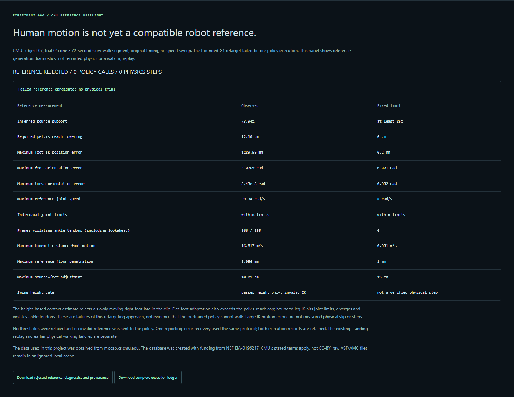

# CMU 07/04: rejected G1 reference, no physical trial

**Outcome:** the single fixed CMU-derived candidate failed reference preflight. No CMU ONNX inference or MuJoCo integration steps ran. Physical steps, progress, falls and contact slip are therefore **unmeasured**, not zero-valued successes. The existing ten-second physics replay, matched comparison, synthetic walking attempts and contract audit are unchanged.

The [saved result](../public/mocap/g1-cmu-07-04-v1.json) contains the complete protocol, source/model hashes, every generated joint pose/velocity, requested and realized reference feet, inferred contacts, failed gates and worst-fit frames. The [execution ledger](../public/mocap/execution-ledger.json) includes the initial reporting error as well as the completed preflight. The browser shows a clearly labeled **reference rejection**, not a reference animation passed off as physical walking.

## Source, terms and exact files

CMU's [primary site](http://mocap.cs.cmu.edu/) permits research and inclusion in commercially sold products, prohibits directly reselling the data even when converted, requests acknowledgment and prohibits crawling. Its [FAQ](http://mocap.cs.cmu.edu/faqs.php) expressly permits copying, modifying and redistributing motion data without permission. These are **CMU's stated terms, not CC-BY**. Only the two files for [subject 07 / trial 04, "slow walk," 120 fps](http://mocap.cs.cmu.edu/search.php?subjectnumber=07) were fetched manually by a fixed allowlist. No other subjects, BONES data, gated data or restricted SuperMimic assets were fetched.

| Asset | Exact URL | Bytes | SHA-256 |
| --- | --- | ---: | --- |
| Subject skeleton | http://mocap.cs.cmu.edu/subjects/07/07.asf | 7,260 | `c29414591d76a34885bff0b04a2666bf9659f869751a2549591c55277cf95b04` |
| Selected motion | http://mocap.cs.cmu.edu/subjects/07/07_04.amc | 359,277 | `c37994b8eefa0cf30d1822db05e698f7ce6098400b462cc0fadd185cafa3301e` |

Retrieved at `2026-10-22T00:48:19.198943+00:00`. The primary asset URLs use HTTP; the pinned hashes identify the observed content but do not provide independent transport authentication. Raw ASF/AMC files remain under ignored `.research-cache/cmu-07-04/`, not in Git or the browser bundle. Committed poses are derived reference diagnostics, permitted by the stated modification/redistribution terms, not raw source files or a resale product.

**Acknowledgment:** The data used in this project was obtained from mocap.cs.cmu.edu. The database was created with funding from NSF EIA-0196217.

## Safe parsing and coordinate checks

`cmu.py` reads ASCII numeric ASF/AMC only: no executable deserialization, pickle, upstream Python or motion-loader package. Fetches have fixed size limits and both pinned digests are verified before parsing. The reader rejects nonfinite/non-numeric values, missing/duplicate channels, nonconsecutive frames, disconnected/cyclic skeletons and unsupported root conventions. Source channel-limit metadata is not used to silently clip observed human motion.

The [ASF/AMC format description](https://research.cs.wisc.edu/graphics/Courses/cs-838-1999/Jeff/ASF-AMC.html) specifies axis-basis conjugation and left-to-right row-vector rotation order. The column-vector implementation uses the corresponding reversed matrix composition and `parent @ C @ motion @ C.T`, then advances each segment along its own rotated rest direction. CMU's FAQ gives the scale: `0.0254 / 0.45 = 0.05644444444444444 metres` per file-length unit, applied to skeleton lengths and root translations.

The source has 30 bones and 449 frames: 3.733333 seconds between first and last samples. All bone lengths remain rigid under FK. Root height is approximately 0.904-0.997 m; net travel is about 3.46 m, despite the "slow walk" label. Timing is retained, not slowed to favor the policy.

Source Y-up coordinates map to G1 Z-up as `[x, y, z] -> [z, x, y]`, a proper rotation, then a constant yaw aligns net travel with +X. Initial root XY is translated to zero. Full pelvis/torso orientations are transformed on both world and local bases, interpolated with quaternion SLERP; they are not replaced by upright identities.

## Fixed candidate scope

`cmu-protocol.json` was frozen before generation. SHA-256: `93c203fa71a194fba463fcb8acc745c2628f0f8090e2c2327a3e5d1673c22a49`.

- Use source time 0-3.72 s, resampled to 50 Hz. Eight additional lookahead samples hold the final pose; velocities are finite differences through that hold. There are 195 generated frames, including lookahead.
- Apply a symmetric seven-frame binomial filter to source positions, with replicated edges. No time warping.
- Scale by the exact G1 hip-roll-to-knee-to-ankle length relative to human femur+tibia: G1 0.622624 m, human left/right 0.808831/0.806271 m, uniform scale **0.771004**. Adapt hip width using G1 hip offsets and the source hip-to-ankle vectors.
- Infer contact from the smoothed forefoot/toe midpoint: below that foot's fifth-percentile height +4.5 cm and horizontal speed below 0.5 m/s. Close gaps up to 0.05 s and discard stances shorter than 0.10 s. These are inferred labels, not instrumented ground-truth contacts.
- Hold each stance ankle XY at its interval median, ankle height 0.035 m, and yaw at its interval median. Blend corrections across swings with a quintic curve; flatten foot pitch/roll. The 0.035 m height corresponds to the retained G1 foot capsules.
- Preserve the scaled root path and full body orientation with one ground offset. A predeclared geometric projection lowers the pelvis only when hip-to-ankle reach would exceed 98% of nominal G1 leg length, capped at 6 cm. This is a morphology heuristic, **not a proof of minimum feasible root height**.
- Use exact-model, bounded damped least-squares six-joint leg IK and a three-joint waist orientation solve. Arms stay nominal. Check individual joint limits and coupled ankle tendons independently; individual joint limits alone do not ensure feasible ankles.

Reference acceptance requires foot position error at most 0.2 mm, foot orientation error at most 0.001 rad, torso error at most 0.002 rad, joint speed at most 8 rad/s, stance ankle motion at most 0.001 m/s, floor penetration at most 1 mm, foot correction at most 15 cm, inferred support at least 85%, swing height at least 2 cm, and valid joint/tendon bounds. All gates must pass.

The prospective physical protocol permits one trial of at most 3.72 s / 120 wall seconds. It retains the earlier fall, tracking and slip definitions, requires at least one verified step per foot for this shorter clip, and would require 70-130% of reference progress. **It was never activated.** The reference begins with an airborne left foot; its first landing would not count as a verified step. No shared rollout initialization was changed for an invalid reference.

## Measured preflight rejection

Runtime: Python 3.11.9, NumPy 2.2.6, MuJoCo 3.3.7, existing isolated CPU environment. No new dependency was installed.

| Reference diagnostic | Observed | Fixed gate |
| --- | ---: | ---: |
| Inferred source support | **73.9421%** | At least 85% |
| Maximum requested geometric pelvis lowering | **0.121027 m** | At most 0.06 m |
| Maximum foot-position IK residual | **1.289587 m** | At most 0.0002 m |
| Maximum foot-orientation residual | **3.076917 rad** | At most 0.001 rad |
| Maximum torso-orientation residual | 0.0000000843 rad | At most 0.002 rad |
| Maximum joint velocity | **59.340794 rad/s** | At most 8 rad/s |
| Individual joint limits | Within bounds | Within bounds |
| Frames violating ankle tendons, including lookahead | **166 / 195** | 0 |
| Maximum generated stance-ankle XY motion | **16.816654 m/s** | At most 0.001 m/s |
| Maximum reference floor penetration | **0.001056 m** | At most 0.001 m |
| Maximum foot-path correction | 0.102100 m | At most 0.15 m |
| Reference root progress | 2.662718 m | Not physical progress |

Eight of twelve gates fail. The nominal swing-height check passes only because the diverged IK places feet implausibly high; this is explicitly **not** usable foot clearance or a step. Large generated foot-motion values are diagnostics of a bad kinematic candidate, not physical contact slip.

### Concrete blockers, separated from policy behavior

**Contact inference fails independently of G1 IK.** At source time 3.10 s, the right forefoot/toe midpoint moves horizontally at only **0.03510 m/s**, but its height **0.070823 m** exceeds the fixed per-foot threshold **0.055170 m**. It is rejected by the height test, not the speed test. Neither foot is labeled supporting during 2.8167-3.7333 s. This is a classifier/ground-alignment limitation, not evidence that the human actually flew for nearly a second.

**The flat-foot/locked-ankle adaptation exceeds the root-adjustment budget.** The required 12.1 cm lowering comes from the specified geometric projection before the leg solve. Long human stance intervals, rolling feet and differing robot morphology are not resolved by uniform leg scaling plus a fixed flat ankle. The cap remains 6 cm; it was not enlarged after seeing the failure.

**The bounded leg solver is not robust to this incompatible target sequence.** The first frame already clamps the left ankle-pitch joint near -0.87266 rad. Later warm-started solves hit multiple hip/knee/ankle limits and diverge; the worst sample at 2.12 s places a requested 3.5 cm-high stance ankle at about 1.30 m. Tendon constraints reject these candidates. This establishes that this solver/target construction failed, **not** that all solutions of a full-body retargeting problem are infeasible.

The smallest follow-up remains the same licensed clip: a separately specified contact-aware retargeter with ground/heel/toe geometry, permitted foot rocking, coupled ankle constraints and bounded whole-body root adaptation, validated before any policy trial. A known-good licensed G1 motion would still be the stronger positive control. This checkpoint does not establish policy compatibility, physical walking, generalization or SOTA.

## Reproduction and complete execution accounting

Follow the existing [isolated environment and model setup](README.md#reproduce-on-windows), then:

```powershell
& research\.venv\Scripts\python.exe research\cmu.py --fetch
& research\.venv\Scripts\python.exe -m unittest discover -s research -p "test_cmu.py" -v
& research\.venv\Scripts\python.exe -m unittest discover -s research -p "test_retarget_cmu.py" -v
& research\.venv\Scripts\python.exe research\retarget_cmu.py --output .research-cache\cmu-preflight-reproduction.json
```

The last command is expected to exit nonzero **after saving the rejected candidate**. It creates output exclusively and refuses to overwrite an existing result. This is a reference-preflight program, not an inference command. A future valid candidate would be labeled `reference_ready`, not a physical success.

The first execution completed generation but failed reporting because a NumPy Boolean reached JSON serialization. Its initial reservation survives byte-for-byte as `interrupted-preflight.json`, still carrying its original `running` field; the ledger explicitly resolves it as **serialization_error**, not an active process. The second execution converted the penetration metric to a native float and synchronized held-pose diagnostic arrays. It used the **same protocol hash**, source, contact thresholds and retarget parameters. There was no parameter sweep or physics tuning.

Regression checks reproduce the rejection, recompute FK/tendon checks and velocities, verify the hold, independently demonstrate the source-contact rejection, exercise safe parsing and refuse evidence overwrite. Other deployment regression tests still exercise the previous stand/arm physics independently; those are not CMU trials. All earlier measured artifacts remain byte-for-byte unchanged.

For this checkpoint, all **40 Python checks**, **6 kinematic tests**, the TypeScript/Vite build and both affected serial browser checks passed. Browser coverage includes existing replay controls, comparison/walking evidence, all twelve mocap rows, mobile overflow and explicit missing/unfinished mocap-data errors. The other seven unchanged browser checks were not rerun. The existing large shared Three.js chunk advisory remains nonfatal.

```powershell
& research\.venv\Scripts\python.exe -m unittest discover -s research -p "test_*.py" -v
npm test
npm run build
npx playwright test physics.spec.ts --grep "physics replay displays|mocap"
```


