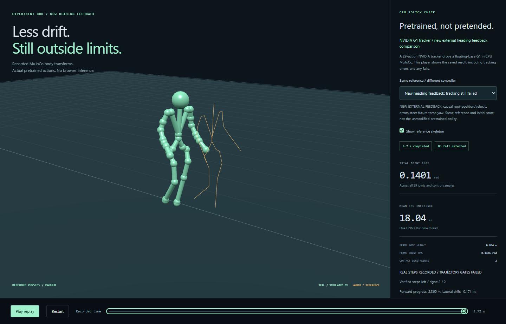
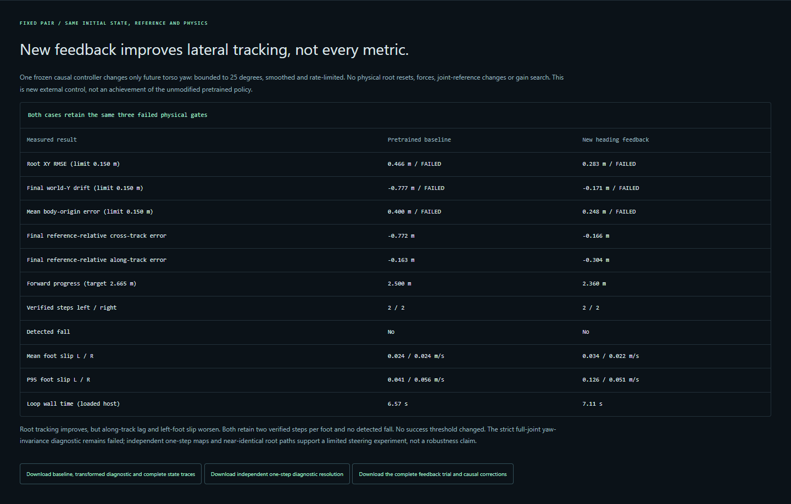

# Path tracking: improved by new feedback, still outside the fixed limits

**One frozen, causal heading-feedback controller reduces root XY RMSE by 39.23% and final reference-relative cross-track error by 78.49%. It does not pass the full walking criteria.** Both cases retain two verified steps per foot, no fall and no numerical warning. Along-track lag and left-foot slip worsen.

This is **new external feedback around the pretrained policy**, not a newly discovered achievement of the original policy. No training, source changes, reference-speed changes, gain search, artificial forces or post-initialization state assignments were used. The exact saved CMU v2.2 reference, initial pose/velocity, 3.72-second duration, dynamics and physical thresholds remain unchanged. The original recording and all preceding evidence are preserved.

Recorded comparison: `http://127.0.0.1:4173/physics.html?replay=path`. Select either the unmodified pretrained baseline or new feedback. The amber reference is unchanged and never aligned to the realized trajectory to hide error.

## Diagnose before steering

### Metrics and world origin

The original `final_lateral_drift_m` is actual world-Y displacement from the initial root, **not** error against reference displacement. It is translation-invariant but is tied to the original +X-aligned experiment axes. The reference itself moves -0.005452 m in Y. Subtracting that displacement gives -0.771757 m of relative Y error, not a successful trajectory.

For an independent coordinate-invariant measurement, this checkpoint also projects actual-minus-reference positions onto the reference start-to-end course and its perpendicular. Baseline final cross-track error is **-0.772093 m**. Root XY RMSE is still **0.466413 m**; its original Euclidean actual-minus-reference definition was already independent of world translation/yaw. The original body error likewise compares both bodies in the same world frame.

The additional path-frame measurements do not replace or relax any physical gate. Baseline and feedback are judged in the original experiment coordinates. The rotated diagnostic's absolute-axis progress/drift fields are not used as a competing walking trial.

### Initialization, source sway and derivatives

MuJoCo free-joint translation velocity is **world-frame**; its angular velocity is **pelvis-local**. Independent position integration, quaternion-log differences, body Jacobians and world/body angular-velocity conversions confirm these conventions. The saved reference's translation/joint derivatives agree exactly with finite differences; angular discrepancy is at most 1.17e-15 rad/s. Future offsets remain 1, 2, 4 and 8 control frames, or 0.02, 0.04, 0.08 and 0.16 seconds.

The initial fitted root velocity `[0.548023, -0.298527, -0.043526] m/s` is **not the raw source derivative**. The source-derived, scaled/smoothed root starts at approximately `[0.438539, -0.070256, 0.022607] m/s`. At frame zero the G1 left ankle roll reaches its lower joint bound. The fitted root adapts by `[-2.182, +4.574, +1.342] mm`; at the next frame that correction is nearly zero. Differentiating that valid fitted motion contributes the extra initial sideways velocity.

This is a documented reference-engineering limitation, not a world/body velocity conversion error. Independently replacing that velocity with zero or the human-source derivative would no longer match the fitted trajectory. No such replacement was made.

Initial momentum alone does not establish the cause of the full drift: actual lateral velocity recovers to about -0.0525 m/s at 0.20 s, when root-Y tracking error is only -0.0276 m, but later drift continues to accumulate. At 2.0 s baseline actual COM lateral velocity is -0.0887 m/s versus reference +0.1257 m/s. At 3.0 s it is -0.2320 versus -0.0412 m/s. The artifact records every control sample's root/torso yaw, root velocity, whole-body COM and COM velocity for both reference and actual motion.

Pelvis and torso headings legitimately differ through waist articulation. For example, initial reference pelvis yaw is +3.552 degrees while torso yaw is -1.398 degrees. Source yaw need not equal instantaneous root-velocity course during lateral sway. No evidence supported reinterpreting the graph's torso anchor as pelvis yaw, rotating world root velocity again, or relabeling heading error as a contract bug.

### Common-yaw/translation invariance, including its failed check

The fixed diagnostic rotates both initial state and every reference pose by **37 degrees**, translates by **[1.2, -0.7, 0] m**, rotates root linear velocity accordingly and leaves body-local angular velocity and all joints unchanged.

| Diagnostic | Measured |
| --- | ---: |
| Original baseline root reproduction error | Exactly 0 |
| Common-transform raw observation maximum discrepancy, seven held states | 1.79e-7 |
| Actual ONNX target maximum discrepancy, seven held states | 1.20e-6 rad |
| Full-run inverse-transformed root maximum separation | 0.003828 m |
| Difference in mean body tracking error | 0.0000476 m |
| Full-run maximum joint difference | **0.250863 rad: fails frozen 0.02 rad check** |
| Maximum joint difference through 1.0 s | Below 1e-6 rad |

The full-joint failure remains recorded in `diagnosis.json`, whose `passed` is **false**. It was not overwritten or reclassified. The largest late difference is left ankle roll at 3.66 s; other peaks are ankle pitch/knee motion near the end.

To distinguish an instantaneous coordinate error from accumulated closed-loop sensitivity, a separately recorded resolution initializes **eleven pairs of independent 20-substep physics maps** from identical saved held states/PD targets under that same rigid transform. No policy is called in these maps. They preserve pose to a maximum joint difference of **4.06e-15 rad**, root difference **1.78e-15 m**, and velocity difference **4.67e-13**. The original graph/frame checks, original 1 cm root-path tolerance, relative tracking within 1 mm and identical verified-step counts also hold.

These additional checks justify a limited steering experiment in the unchanged nominal frame; they do **not** establish exact long-horizon joint equivariance or robustness. Small float32 policy differences and contact sensitivity can amplify over time. The precise amplification mechanism is not proven. The strict diagnostic's failed flag and the independent resolution coexist.

## Frozen new feedback control

The exact [protocol](path-tracking-protocol.json), including controller constants, was written **before any of the three full rollouts**. The reduced-coordinate graph consumes each future torso rotation relative to the current torso: [pinned upstream target observation, lines 442-448](https://github.com/NVlabs/ProtoMotions/blob/f69fdcaabff31846b4d2247207417b57dc788828/protomotions/envs/obs/target_poses.py#L442-L448). Independent tests confirm that changing these quaternions changes actual ONNX output while untouched channels remain identical.

The controller uses the known reference start-to-end course as its horizontal frame:

1. At each 50 Hz control sample, read **current simulated** root position/velocity and the reference at that same time.
2. Form reference-minus-actual cross-track position and lateral-velocity errors.
3. Compute a yaw offset with `atan2(position_error / 1 second + velocity_error, max(reference_forward_velocity, 0.25 m/s))`.
4. Clamp to +/-25 degrees, low-pass with a 0.15-second time constant, then limit changes to 60 degrees/second.
5. Left-multiply **all four** future torso quaternions by the same world-up yaw offset. Hold that correction over the future horizon, preserving their mutual relative rotations.

The one-second recovery constant, unit velocity gain, smoothing near the policy's 0.16-second horizon and modest yaw/rate limits are interpretable engineering choices, not parameters fitted until a run succeeded. Joint positions/velocities, contact schedule and all world-space reference bodies remain unchanged. No root-position target is smuggled into the graph; the new controller explicitly uses root errors outside the pretrained policy to choose supported orientation targets.

The correction reaches **24.4845 degrees**, reaches the 60-degree/second rate bound, and its raw demand exceeds the 25-degree bound on **18.28%** of control samples. This bounded channel improves steering but does not independently command forward speed or guarantee arbitrary trajectory tracking.

## Matched results: include the tradeoffs

| Measurement | Unmodified pretrained baseline | New heading feedback |
| --- | ---: | ---: |
| Completed simulation | 3.72 s | 3.72 s |
| Policy calls / physics steps | 186 / 3,720 | 186 / 3,720 |
| Verified steps, L / R | 2 / 2 | 2 / 2 |
| Detected falls / numerical warnings | 0 / 0 | 0 / 0 |
| Forward progress; target 2.664687 m | 2.499748 m | 2.359971 m |
| Original world-Y drift; limit +/-0.15 m | **-0.777209 m, failed** | **-0.170917 m, failed** |
| Root XY RMSE; limit 0.15 m | **0.466413 m, failed** | **0.283434 m, failed** |
| Mean body-origin error; limit 0.15 m | **0.399599 m, failed** | **0.248043 m, failed** |
| Cross-track RMSE | 0.444721 m | 0.175959 m |
| Final reference-relative cross-track error | -0.772093 m | -0.166088 m |
| Final reference-relative along-track error | -0.163360 m | **-0.304377 m, worse** |
| Joint RMSE | 0.140094 rad | 0.140059 rad |
| Supported samples after 0.5 s | 96.2963% | 97.5309% |
| Mean contact slip, L / R | 0.024035 / 0.024043 m/s | **0.034181** / 0.022012 m/s |
| P95 contact slip, L / R | 0.040857 / 0.056281 m/s | **0.126015** / 0.050971 m/s |
| Mean / p95 ONNX inference | 16.17 / 31.89 ms | 18.04 / 31.96 ms |
| Loop wall time, including instrumentation | 6.574 s | 7.109 s |

The forward-progress band and slip limits still pass. Root XY RMSE improves **39.23%**, cross-track RMSE **60.43%**, and final cross-track magnitude **78.49%**. Along-track lag increases **86.32%** and left-foot slip increases. The same three physical gates fail in both cases; even the corrected relative cross-track endpoint remains beyond 0.15 m. Timings include host load and instrumentation and are not controlled speed benchmarks.

This is verified improved tracking, **not full path-tracking success**. There was no second feedback candidate, threshold change, source selection, camera/reference alignment or hidden successful trial.

## Evidence and reproduce

`public/path-tracking-v1/` contains:

| File | Meaning |
| --- | --- |
| `diagnosis.json` | Reproduced baseline and common-transform rollout, all states/commands/contact samples, reference COM/yaw/velocity diagnostics, 14 static policy probes; strict joint check failed |
| `invariance-resolution.json` | Eleven independent one-step map pairs, 440 physics steps and zero policy calls; separate checks pass without erasing the strict failure |
| `feedback.json` | The single feedback rollout, every causal yaw correction, complete states/actions/physical outcome |
| `physics-replay.json` | Exact measured baseline/feedback frame projection, with source artifact digests; not a new simulation |

The three full rollouts total **558 policy calls and 11,160 physics steps**. The 14 static policy probes and 440 independent-map steps are separately counted; regression tests are not additional tuning trials. Diagnosis's executed code is preserved in commit `7eff02c`. Every stage stores its source/protocol/model/reference hashes, and later stages link earlier artifacts by digest. Model/package setup is the same existing pinned Python 3.11 environment; no dependency or dataset was added.

After the existing [environment and asset setup](README.md#reproduce-on-windows), use a new output directory:

```powershell
& research\.venv\Scripts\python.exe -m unittest discover -s research -p "test_path_tracking.py" -v
& research\.venv\Scripts\python.exe research\path_tracking.py --stage diagnose --output-dir .research-cache\path-reproduction
& research\.venv\Scripts\python.exe research\path_tracking.py --stage resolve --output-dir .research-cache\path-reproduction
& research\.venv\Scripts\python.exe research\path_tracking.py --stage feedback --output-dir .research-cache\path-reproduction
& research\.venv\Scripts\python.exe research\export_path.py --input-dir .research-cache\path-reproduction
```

Run commands separately and inspect their saved outcomes. Diagnosis intentionally exits nonzero for its retained strict joint-invariance failure. Resolution must pass its independent checks before the runner permits feedback. Feedback likewise exits nonzero after saving the complete result because physical gates still fail. Outputs are exclusive and cannot overwrite existing results. The feedback gains/protocol are identical to those frozen before diagnosis.

The unchanged original replay remains at `?replay=cmu`, and standing/arm playback remains at `/physics.html`. The new viewer switches the baseline and corrected real recordings, updates their selected-case outcomes, and shows both improvements and degradation. Missing data or a missing comparison case is an explicit error, not a synthetic/uncorrected fallback.

The research regression suite passes **59 checks**, including independent actual-graph tests, causal reconstruction of recorded feedback/ONNX commands, unchanged reference/initialization/gates, independent outcome recomputation, exact exported physics and historical artifact digests.

Six kinematic tests, TypeScript/Vite build and **six affected serial browser checks** also pass. The latter cover the original standing/arm replay, preserved CMU trial, new case switching/metrics, mobile overflow, missing data and rejection of a missing baseline. An old screenshot selector initially selected the new hidden comparison section; it was changed to identify the original section explicitly and passed on rerun. The other eight browser checks were not rerun in this checkpoint. The existing shared Three.js chunk-size advisory remains nonfatal; `pip check` reports no broken requirements.

All 20 previously committed public artifacts/screenshots are unchanged. Live HTTP result/replay bytes match disk. Protocol SHA-256 is `3117b37f4a2a42bd4880866dd59a4b8e993a18e91d6eeb98def39cf43d280b5d`; feedback artifact SHA-256 is `47a42ad433716438d8eb32e2e9d89c081914dd1e1f655ca328557cd866dcfee0`.

Source and model terms remain unchanged: CMU stated terms with NSF EIA-0196217 attribution, not CC-BY; raw motion and licensed weights remain ignored. No BONES data, restricted SuperMimic assets, gated acceptance, paid compute, external upload, training or SOTA claim.




